<div align="center">

# 咲く Saku

Ein lokaler Trainer für die IHK-Abschlussprüfung der Fachinformatiker/-innen (AP1 und AP2):
die Systematik einer Fahrschul-App, die Ruhe japanischer Gestaltung und ein KI-Tutor, der jede Aufgabe kennt.

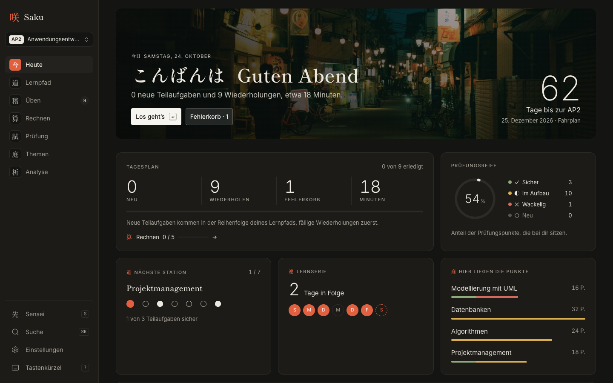

</div>

---

## Was ist Saku?

Saku macht aus gekauften IHK-Prüfungen einen persönlichen Lernkatalog. Eine Pipeline liest alle Prüfungs-PDFs, zerlegt sie in Teilaufgaben, baut sie mit Claude als echten Text neu auf und ordnet sie den Themen aus Prüfungskatalog und Rahmenlehrplan zu. Gelernt wird danach wie in einer Fahrschul-App: Jede Teilaufgabe hat einen Lernstand, eine Teilaufgabe ist erst sicher, wenn sie zweimal hintereinander klappt, und eine Prüfungsreife-Anzeige sagt ehrlich, wie weit man ist.

Der Name kommt von 咲く (*saku*), „erblühen“. Wissen wächst in Saku wie ein Garten, bis zur vollen Blüte, 満開 (*mankai*), dem Moment der Prüfungsreife.

## Bereiche

| | | |
|---|---|---|
| 今 | **Heute** | Cockpit: Tagesplan, Countdown, Prüfungsreife als Ensō, Lernkalender |
| 道 | **Lernpfad** | Stationen, jede mit Einführung, Übungen und Mini-Test |
| 稽 | **Üben** | Fokusmodus: Aufgabe als echter Text, anklickbare Antworten, Lösung per Leertaste, Bewertung mit 1, 2, 3; nach einem Fehler kommt eine ähnliche Aufgabe aus einem anderen Jahrgang; Grundwissen als Begriffs-Karten |
| 試 | **Prüfung** | Simulation mit Timer, Note und Hanko-Stempel |
| 庭 | **Themen** | Wissensgraph aus Themen, Lernfeldern und Fachbegriffen; je Thema eine Wissensseite (was du können musst, so wird gefragt, Fallen) |
| 先 | **Sensei** | KI-Tutor: Tipps, Erklärungen, Antworten prüfen, Übungsvarianten, Chat mit Quellen |
| 析 | **Analyse** | alle Prüfungen: Heatmap, Dauerbrenner, Lücken |
| ⌘K | **Suche** | Befehlspalette und Suche nach Wort und Bedeutung über alle Prüfungen |

## So sieht Saku aus

Alle Bilder zeigen die erfundenen Demo-Daten, keine echten Prüfungsaufgaben.

<table>
  <tr>
    <td width="50%">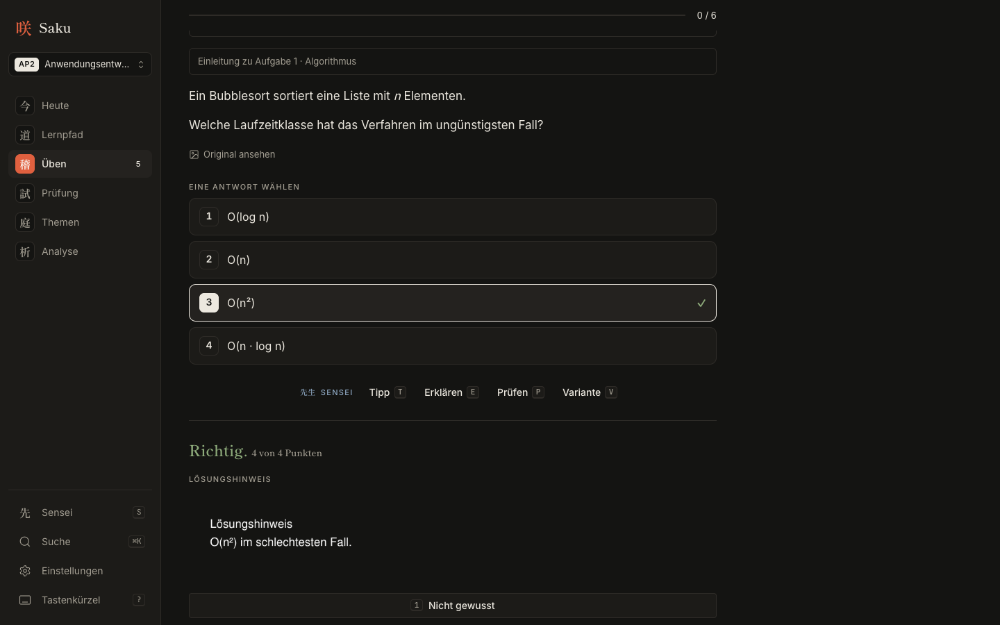<br><b>稽 Üben.</b> Aufgabe als Text, Antwort per Zifferntaste, ↵ prüft sofort. Bei freien Antworten schlägt Sensei Punkte nach dem IHK-Schlüssel vor.</td>
    <td width="50%">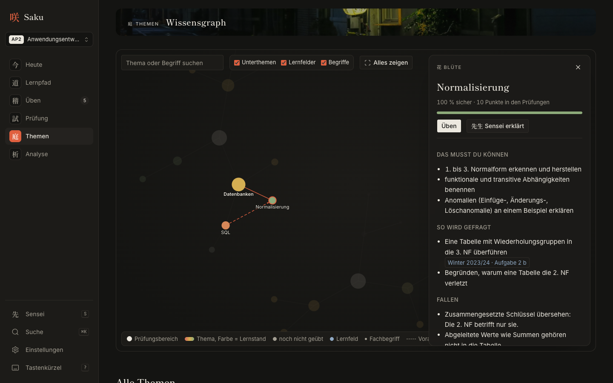<br><b>庭 Themen.</b> Wissensgraph aus Themen, Lernfeldern und Fachbegriffen. Jede Notiz hat eine Wissensseite mit Verweisen auf echte Aufgaben.</td>
  </tr>
  <tr>
    <td>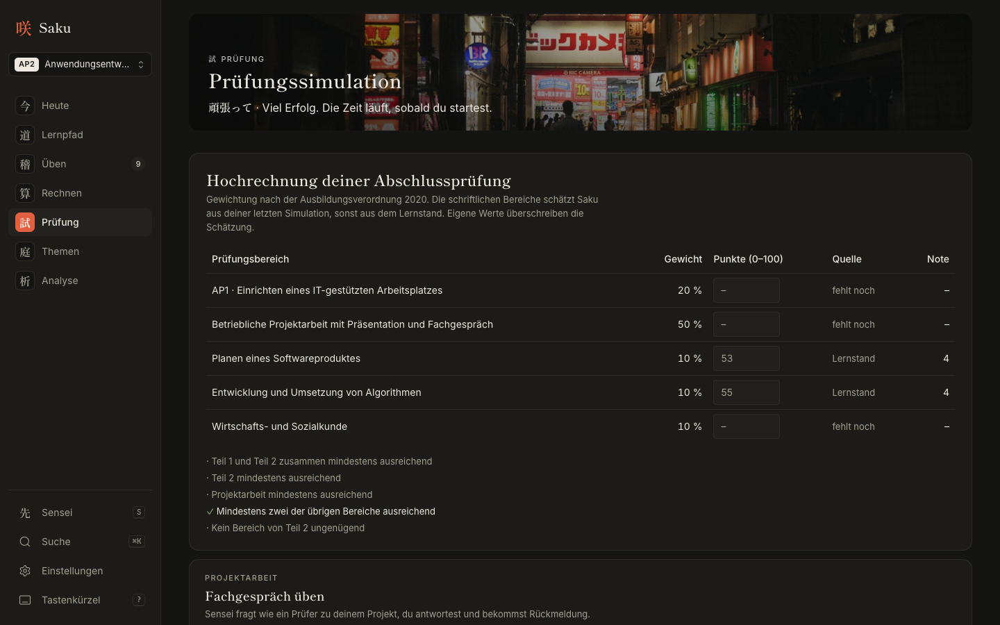<br><b>試 Prüfung.</b> Simulation im Heft-Layout und Hochrechnung der Gesamtnote samt Bestehensregeln der AO 2020.</td>
    <td>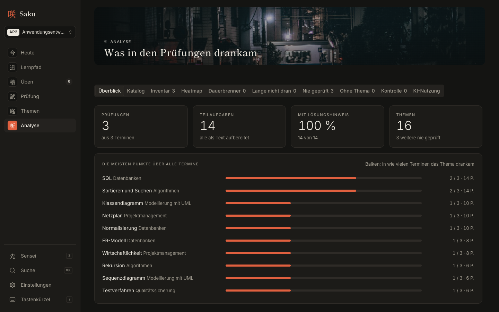<br><b>析 Analyse.</b> Was wie oft drankam, Heatmap, Dauerbrenner, Themen, die lange nicht dran waren, und der Katalog als Checkliste.</td>
  </tr>
  <tr>
    <td>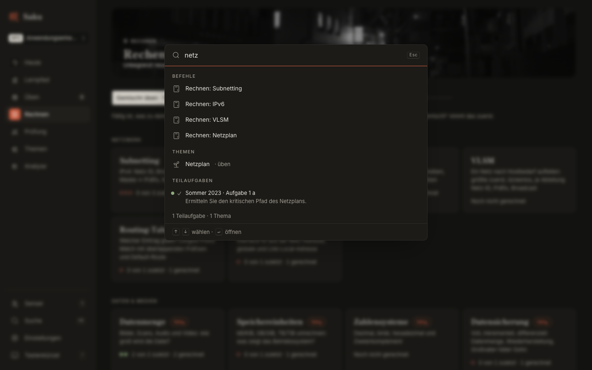<br><b>⌘K.</b> Befehle (Simulation, Termin, AP1/AP2, AE/SI, Farbschema) und Suche nach Wort und Bedeutung.</td>
    <td>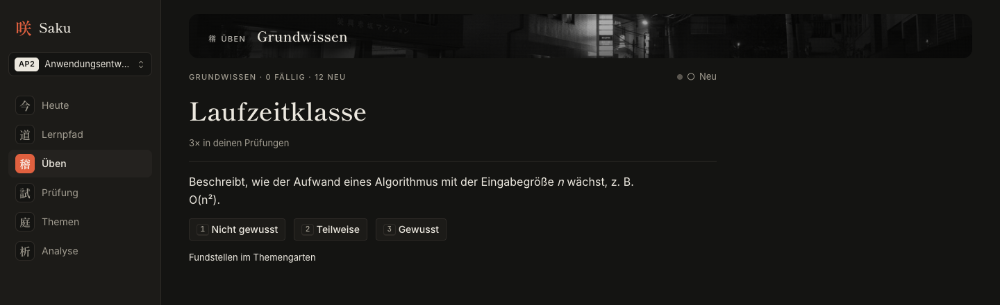<br><b>Grundwissen.</b> Fachbegriffe als Lernkarten mit eigener Wiederholungsplanung.</td>
  </tr>
</table>

## Wie Saku funktioniert

Saku läuft komplett auf dem eigenen Rechner. Die Prüfungen werden einmal analysiert, danach lernt man nur noch in der App.

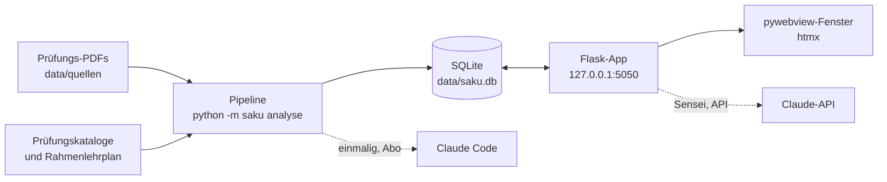

### Die Pipeline

Jeder Schritt ist wiederholbar: Unveränderte PDFs werden übersprungen, KI-Antworten kommen beim zweiten Lauf aus dem Cache, und der Lernstand bleibt erhalten. Die KI-Schritte sind markiert.

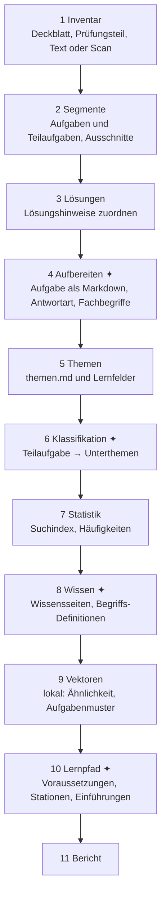

✦ = Claude. Der Erstlauf geht über Claude Code (`--ki claude-code`), Vektoren rechnet [fastembed](https://github.com/qdrant/fastembed) lokal und kostenlos.

### Die Lernschleife

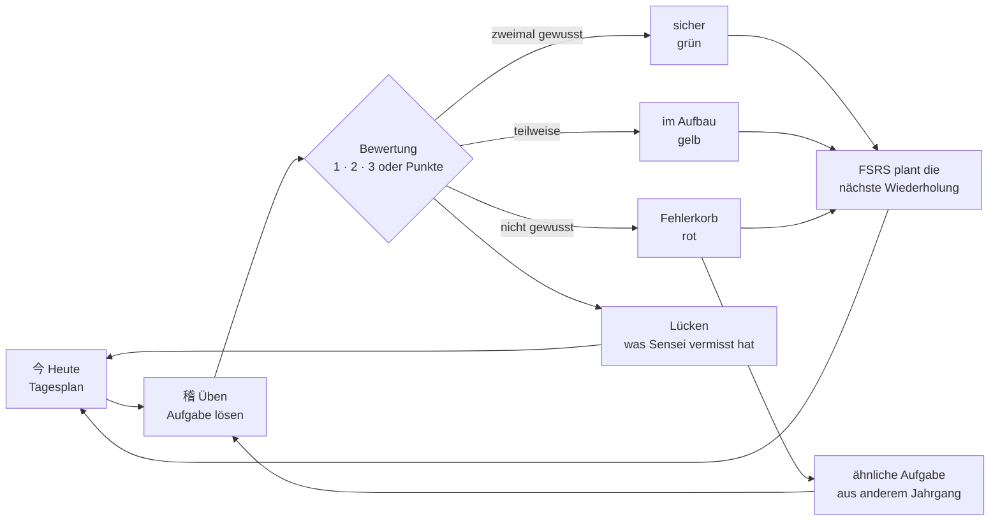

Eine Teilaufgabe ist erst sicher, wenn sie zweimal hintereinander klappt. Die Prüfungsreife zählt, wie viele Prüfungspunkte sicher sitzen, und die Wiederholungen enden spätestens am Prüfungstag.

### Eine Anfrage in der App

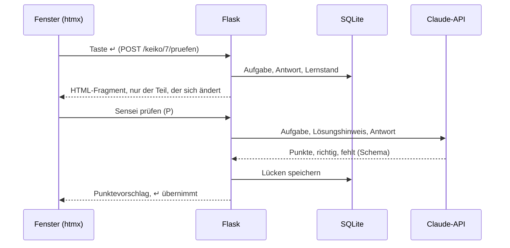

## Stand

Alle Phasen der [Roadmap](docs/ROADMAP.md) sind umgesetzt, 131 Tests laufen grün. Saku deckt **Fachinformatiker/-in Anwendungsentwicklung (1201) und Systemintegration (1202)** ab, jeweils **AP1 und AP2** samt WiSo; umgeschaltet wird oben in der Seitenleiste. Die Aufgaben baut Claude einmalig aus den PDF-Ausschnitten als echten Text neu auf (Tabellen, Code, anklickbare Antworten). Standard ist das dunkle Farbschema.

## Schnellstart

```bash
python -m venv .venv
source .venv/bin/activate          # Windows: .venv\Scripts\activate
pip install -r requirements-dev.txt
cp .env.example .env               # Windows: copy .env.example .env
                                   # für Sensei den API-Schlüssel in .env eintragen

# Prüfungen (PDFs, ZIPs) nach data/quellen/, Themenliste nach data/themen.md
python -m saku.pipeline.sammeln       # AE, SI, AP1 und WiSo nach data/pdfs/ kopieren
python -m saku init                    # Datenbank anlegen
python -m saku assets                  # Oberflächen-Dateien und Schriften laden (einmalig)
python -m saku analyse --ki claude-code  # Erstlauf: KI-Schritte über das lokale Claude Code
python -m saku start                   # App im eigenen Fenster öffnen (--browser: im Browser)
```

Beim ersten Start führt eine kurze Tour durch Saku: was die Analyse gefunden hat, Prüfungstermin, Lernweg, Tastatur und Sensei. Später erreichbar über die Einstellungen oder die Tastaturhilfe (`?`).

Die einmaligen KI-Schritte der Analyse (Deckblätter, Aufgaben neu aufbauen, Klassifikation, Wissensseiten und Begriffe, Lernpfad, Einführungen) laufen beim Erstlauf über das lokal installierte [Claude Code](https://code.claude.com) (`claude -p`, eigenes Login, kein API-Schlüssel nötig). Spätere Läufe und Sensei nutzen die Claude-API. Beide Wege teilen sich denselben Cache, eine schon beantwortete Anfrage kostet also nichts mehr. `python -m saku analyse --ohne-ki` läuft komplett lokal.

Ohne Prüfungs-PDFs lässt sich Saku mit erfundenen Demo-Daten ausprobieren:

```bash
python -m tests.demo_daten /tmp/saku-demo
SAKU_DATENORDNER=/tmp/saku-demo python -m saku start --browser
```

## Dokumentation

| Dokument | Inhalt |
|---|---|
| [Konzept](docs/KONZEPT.md) | Idee, Bereiche, Fahrschul-Lernlogik, Prüfungsreife |
| [Architektur](docs/ARCHITEKTUR.md) | Tech-Stack, Projektstruktur, Pipeline, Routen |
| [Design](docs/DESIGN.md) | Prinzipien, Farben, Typografie, Signature-Momente |
| [Sensei](docs/SENSEI.md) | KI-Tutor: Modi, Prompts, Chat mit Quellen, Kosten |
| [Roadmap](docs/ROADMAP.md) | Phasen, Demo-Ablauf, Risiken |
| [Schema](db/schema.sql) | SQLite-Datenbank mit Sichten und Volltextsuche |

## Technik

Python 3.12+ · Flask · SQLite mit FTS5 · PyMuPDF · Claude-API und Claude Code · fastembed · scikit-learn · Basecoat (shadcn/ui-Look) · htmx · FSRS · networkx · force-graph · pywebview

## Daten und Urheberrecht

IHK-Prüfungen sind urheberrechtlich geschützt. **Dieses Repo enthält keinerlei Prüfungsinhalte.** PDFs, erzeugte Bildausschnitte, Themenliste, Modelle und die Datenbank liegen im Ordner `data/`, der per `.gitignore` ausgeschlossen ist. Tests und Bilder nutzen nur erfundene Aufgaben. Saku ist für den privaten Gebrauch mit selbst gekauften Prüfungen gedacht.

Für die KI-Funktionen werden Aufgabentexte an die Claude-API übertragen. Der API-Schlüssel steht nur in der lokalen `.env`.

## Bildnachweise

Die Bildbänder der Bereiche nutzen Fotos von [Unsplash](https://unsplash.com) (Unsplash-Lizenz): Ayumi Kubo (Heute, Einführung), Nguyen Minh (Lernpfad), Dino Sabic (Üben), Ricky T (Prüfung), Shigeki Wakabayashi (Themen), Masahiro Miyagi (Sensei), Andre Benz (Analyse) und Grant Lee (満開).
