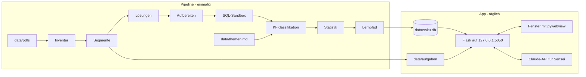
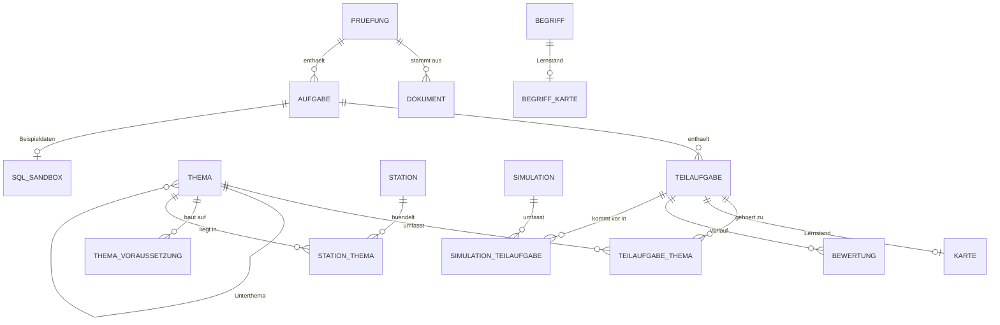

# Architektur

Saku besteht aus zwei Teilen, die sich eine SQLite-Datenbank teilen:

1. **Die Pipeline** analysiert die Prüfungs-PDFs und baut daraus den Katalog: `python -m saku analyse`
2. **Die App** ist eine lokale Flask-Web-App in einem eigenen Fenster: `python -m saku start`



## Tech-Stack

| Bereich | Technik | Warum |
|---|---|---|
| Sprache | Python 3.12+ | Kurssprache; alles Wesentliche passiert in Python |
| PDFs | PyMuPDF | Text mit Positionen, Ausschnitte als Bild, OCR-Anbindung |
| Datenbank | SQLite mit FTS5 | in Python enthalten, Volltextsuche inklusive |
| KI | Claude-API (`anthropic`) | Deckblätter, Klassifikation, Lernpfad, Tutor, Streaming |
| Web | Flask + Jinja2 | schlank, verbreitet, gut dokumentiert |
| Oberfläche | Basecoat | shadcn/ui-Look als CSS-Klassen, ohne React |
| Interaktion | htmx 2 + SSE-Erweiterung | Interaktivität per HTML-Attribut, Streaming der KI-Antworten |
| Wiederholung | `fsrs` | Wiederholungsplanung wie in Anki |
| Graph | networkx (Lernpfad), force-graph im Browser (d3-force auf Canvas) | Reihenfolge in Python, Wissensgraph wie in Obsidian |
| Ähnlichkeit | scikit-learn, fastembed | TF-IDF über alle Teilaufgaben, Vektoren lokal (ONNX) |
| Markdown | markdown-it-py | KI-Antworten als HTML, eingebettetes HTML wird entschärft |
| Terminal | rich | Fortschrittsbalken und Tabellen in der Pipeline |
| Fenster | pywebview | eigenes App-Fenster statt Browser-Tab |

Eigenes JavaScript steht in einer Datei, `static/js/saku.js`: Tastenkürzel (`data-taste`), Dialoge, Rückmeldung „Gespeichert“, Farbschema, Code-Editor, ausfüllbare Tabellen und das Zeichnen des Wissensgraphen. Alles andere bringen Basecoat, htmx und force-graph mit; die Uhr der Simulation und des Rechen-Sprints steht im jeweiligen Template.

## Projektstruktur

```text
saku/
├── README.md
├── requirements.txt            Laufzeit-Abhängigkeiten
├── requirements-dev.txt        Tests und Werkzeuge
├── .env.example                Vorlage für API-Schlüssel und Modelle
├── docs/                       diese Dokumentation
├── db/
│   └── schema.sql              Datenbankschema (neueste Version)
├── data/                       PRIVAT, nicht im Git
│   ├── README.md
│   ├── themen.example.md       Format der Themenliste
│   ├── themen.md               eigene Themenliste
│   ├── quellen/                gekaufte Prüfungen, auch als ZIP
│   ├── pdfs/                   Prüfungen und Lösungshinweise
│   ├── aufgaben/               erzeugte Bildausschnitte
│   ├── backups/                tägliche Sicherungen, die letzten sieben
│   └── saku.db                 Katalog und Lernstand
├── saku/                       Python-Paket
│   ├── __main__.py             Befehle: init, assets, analyse, start, lernstand, paket, server
│   ├── config.py               liest .env
│   ├── db.py                   Verbindung, Schema, Migrationen, Sicherung
│   ├── assets.py               Fremddateien für den Offline-Betrieb laden
│   ├── paket.py                Archiv für Saku im Netz bauen, prüfen und einspielen (docs/DEPLOY.md)
│   ├── niwa.py                 Wissensgraph: Knoten und Kanten für force-graph, Lehrplan
│   ├── pipeline/               ein Modul je Schritt, Reihenfolge in SCHRITTE (__init__.py)
│   │   ├── sammeln.py          Prüfungen aus data/quellen nach data/pdfs (eigener Befehl)
│   │   ├── pdf.py              Text mit Koordinaten, Tesseract für Scans
│   │   ├── inventar.py         Hash, Deckblatt, Text oder Scan
│   │   ├── segmente.py         Aufgaben, Teilaufgaben, Bildausschnitte
│   │   ├── loesungen.py        Lösungshinweise zuordnen
│   │   ├── aufbereiten.py      Aufgabe als Markdown, Antwortart, Fachbegriffe (KI)
│   │   ├── sandbox.py          SQL-Sandbox: Tabellen, Beispieldaten, Lösungen in SQLite (KI)
│   │   ├── themen.py           themen.md einlesen
│   │   ├── klassifikation.py   Teilaufgaben → Themen (KI)
│   │   ├── statistik.py        Ähnlichkeiten (TF-IDF), Suchindex
│   │   ├── wissen.py           Wissensseiten je Thema, Begriffs-Definitionen (KI)
│   │   ├── vektoren.py         Vektoren, „Kam so ähnlich“, Aufgabenmuster
│   │   ├── lernpfad.py         Voraussetzungen, Stationen
│   │   └── bericht.py          Zusammenfassung im Terminal
│   ├── lernen/
│   │   ├── karten.py           Fahrschul-Regeln, FSRS, Begriffs-Karten und Ablenker
│   │   ├── antwort.py          anklickbare Antworten und SQL automatisch prüfen (vorschlag)
│   │   ├── sql.py              SQL-Sandbox: sicher ausführen, mit der Lösung vergleichen
│   │   ├── stichpunkte.py      Stichpunkt-Abgleich für freie Antworten, ohne KI
│   │   ├── operatoren.py       IHK-Operatoren erkennen (nennen, erläutern …)
│   │   ├── tagesziel.py        Tagesziel, Lerntage, Lernserie, sicher geworden, Prüfungsreife
│   │   ├── fahrplan.py         Prognose, Tempo, Abdeckung nach Prüfungsgewicht, Gewinn je Thema, Meilensteine
│   │   ├── kalender.py         Fahrplan als iCalendar-Datei (RFC 5545)
│   │   ├── rueckblick.py       Wochenrückblick
│   │   ├── pfad.py             Lernpfad: Stationen, Freischaltung, Mini-Test
│   │   ├── simulation.py       Zusammenstellung, WiSo-Schnelltest, Notenschlüssel
│   │   ├── hochrechnung.py     Gesamtnote nach der Ausbildungsverordnung
│   │   ├── lernstand.py        Lernstand exportieren und importieren
│   │   └── rechnen/            Rechentrainer, siehe unten
│   ├── sensei/
│   │   ├── client.py           Claude-API und Claude Code, Cache, Protokoll
│   │   ├── prompts.py
│   │   ├── suche.py            Kontext für den Chat (RAG, Volltext + Vektoren)
│   │   ├── vektoren.py         fastembed lokal, Kosinus, Reciprocal Rank Fusion
│   │   └── werkzeuge.py        exakte Rechnungen als Werkzeug für Sensei
│   └── web/
│       ├── __init__.py         Flask-App-Factory, CSRF-Schutz, Anmeldung, Fehler für zu große Zahlen
│       ├── routen/             ein Blueprint je Bereich, kern.py für Bilder und Einstellungen, anmeldung.py
│       ├── templates/
│       └── static/             css/saku.css und css/bereiche/, js/saku.js, vendor/, fonts/
└── tests/
```

## Pipeline

Die Pipeline läuft in zwölf Schritten. Jeder Schritt ist wiederholbar: Unveränderte Dateien (gleicher SHA-256-Hash) werden übersprungen, KI-Antworten kommen beim zweiten Lauf aus dem Cache, und Daten werden per Upsert aktualisiert, damit der Lernstand erhalten bleibt.

```bash
python -m saku analyse                  # alle Schritte
python -m saku analyse --schritt segmente
python -m saku analyse --ohne-ki        # nur lokale Schritte, kostenlos
python -m saku analyse --ki claude-code # Erstlauf: KI über das lokale Claude Code statt der API
python -m saku analyse --schritt sandbox --ki claude-code  # nur die SQL-Sandboxen
```

| Schritt | Was passiert | Ergebnis |
|---|---|---|
| 1. Inventar | PDFs erfassen, Deckblatt lesen, Text oder Scan erkennen | `dokument`, `pruefung` |
| 2. Segmente | Aufgaben und Teilaufgaben erkennen, Ausschnitte rendern | `aufgabe`, `teilaufgabe`, PNGs |
| 3. Lösungen | Lösungshinweise segmentieren und zuordnen | `loesung_text`, `loesung_bilder` |
| 4. Aufbereiten | Claude baut jede Aufgabe aus den Ausschnitten als Markdown neu auf (KI, Bilder) | `inhalt`, `antwort`, `loesung_inhalt`, `begriff` |
| 5. Sandbox | je Aufgabe mit SQL: Tabellen, erfundene Beispieldaten und Musterlösungen in SQLite (KI, lokal geprüft, wiederaufnehmbar) | `sql_sandbox`, `loesung_sql` |
| 6. Themen | `data/themen.md` und die Lernfelder einlesen | `thema`, `lernfeld` |
| 7. Klassifikation | jede Teilaufgabe Themen zuordnen (KI, nur Bereiche der Prüfung) | `teilaufgabe_thema`, `typ` |
| 8. Statistik | Ähnlichkeiten (TF-IDF, Rückfall) berechnen, Suchindex aufbauen | `aehnlichkeit`, `suche` |
| 9. Wissen | Wissensseite je Thema und Unterthema, Kurzdefinition je Fachbegriff (KI, wiederaufnehmbar) | `thema.beschreibung`, `begriff.erklaerung` |
| 10. Vektoren | lokale Vektoren (fastembed), Ähnlichkeit nach Bedeutung, Aufgabenmuster per Clustering | `vektor`, `aehnlichkeit`, `muster` |
| 11. Lernpfad | Voraussetzungen und Stationen je Pfad (AP1, AP2-1201, AP2-1202) | `thema_voraussetzung`, `station` |
| 12. Bericht | Zusammenfassung im Terminal, Details unter Analyse | rich-Tabellen |

### 1. Inventar

Für jede PDF in `data/pdfs/` (Dateinamen sind egal):

- **Hash** berechnen: erkennt Dubletten und unveränderte Dateien
- **Textebene** prüfen: Haben die meisten Seiten kaum Text, ist es ein Scan
- **Deckblatt** lesen: Termin (Sommer oder Winter, Jahr), Prüfungsbereich, Beruf, Bearbeitungszeit, Art (Aufgaben oder Lösungshinweise), Format (aktuell oder früher, etwa „Ganzheitliche Aufgabe I/II“). Zuerst per regulärem Ausdruck; klappt das nicht, liest das schnelle Modell das Deckblatt und antwortet strukturiert.

**Scans** brauchen Texterkennung. Zwei Wege, entschieden wird nach dem Inventar:

- Tesseract über PyMuPDF (`page.get_textpage_ocr(language="deu")`): kostenlos, aber Tesseract muss mit deutschem Sprachpaket installiert sein
- Claude liest das gerenderte Seitenbild: keine Installation, kostet Tokens

### 2. Segmente

PyMuPDF liefert Text mit Koordinaten (`page.get_text("dict")`). Damit ist für jede Überschrift bekannt, wo sie auf der Seite steht. Typische Muster:

```python
AUFGABE     = re.compile(r"^\s*(?:(\d+)\.\s*(?:Aufgabe|Handlungsschritt)|Aufgabe\s+(\d+))", re.M)
TEILAUFGABE = re.compile(r"^\s*([a-z]{1,2})\)\s", re.M)
PUNKTE      = re.compile(r"\((\d+(?:,\d+)?)\s*Punkte?\)")
```

Die genauen Muster werden an den echten PDFs geschärft. Für jede Teilaufgabe wird der Bereich zwischen ihrem Anfang und dem nächsten Anfang als PNG gerendert (`page.get_pixmap(clip=rechteck, dpi=200)`). Reicht eine Teilaufgabe über einen Seitenumbruch, entstehen mehrere Bilder. Die Ausgangssituation der Prüfung und die Einleitung jeder Aufgabe werden extra gespeichert, weil Teilaufgaben ohne sie oft nicht verständlich sind.

Bilder landen in `data/aufgaben/<hash>/` und werden von der App über eine eigene Route ausgeliefert, nicht über `static/`. So bleiben alle Prüfungsinhalte in `data/`.

### 3. Lösungen

Lösungshinweise werden genauso segmentiert und über Termin, Prüfungsbereich, Aufgabennummer und Kennung zugeordnet. Fehlende Lösungen tauchen im Inventar auf.

### 4. Aufbereiten

Je Aufgabe (bei WiSo mehrere zusammen) bekommt das starke Modell alle Ausschnitte als Bilder (Einleitung, Teilaufgaben, Lösungshinweise) und den erkannten Text als Hilfe. Es antwortet nach Schema: die Aufgabe als Markdown (Tabellen, Code, Listen), die Antwortart (frei, einfach, mehrfach, reihenfolge, zuordnung, zahl, code, sql, tabelle) mit Optionen und der richtigen Lösung aus dem Lösungshinweis, den Lösungshinweis als Markdown und drei bis acht Fachbegriffe. Abbildungen kommen als `` mit Box zurück; Saku schneidet sie aus dem Ausschnitt, bei Text-PDFs als SVG (Seite und Rechteck jedes Ausschnitts stehen in `ausschnitte.json`). Der Schritt ist wiederaufnehmbar: Er bearbeitet nur Aufgaben ohne Inhalt, ein fehlerhaftes Paket hält den Lauf nicht auf. Über Claude Code bekommt `claude -p` nur das Werkzeug Read und nur den Ordner der Bilder (`SAKU_KI_PARALLEL` steuert, wie viele Aufrufe gleichzeitig laufen).

### 5. Sandbox

Für jede Aufgabe mit mindestens einer SQL-Teilaufgabe (Antwortart `sql`) und ohne Sandbox bekommt das starke Modell Einleitung, alle Teilaufgaben und die Musterlösungen. Es antwortet nach Schema: SQLite-DDL, erfundene Beispieldaten (6 bis 15 Zeilen je Tabelle, mit Randfällen wie NULL, Gleichstand, Datumsgrenzen) und je SQL-Teilaufgabe die Musterlösung als lauffähiges SQLite. Saku lädt alles in eine Datenbank im Speicher und führt jede Lösung aus; liefert eine nichts oder scheitert sie, gibt es einen zweiten Versuch mit der Meldung von SQLite, danach bleibt die Aufgabe ohne Sandbox (Meldung im Terminal, beim nächsten Lauf wieder dran). Standardmäßig drei Aufrufe gleichzeitig (`SAKU_KI_PARALLEL`). Wie die App die Sandbox nutzt, steht unter [SQL-Sandbox](#sql-sandbox).

### 6. Themen

`data/themen.md` wird eingelesen, das Format steht in [data/themen.example.md](../data/themen.example.md). Weicht die eigene Liste davon ab, bringt das starke Modell sie einmalig in die Struktur.

### 7. Klassifikation

Für jede Teilaufgabe bekommt das schnelle Modell die Themenliste, die Einleitung der Aufgabe, den Text der Teilaufgabe und den Lösungshinweis. Es antwortet über ein Werkzeug mit festem Schema (siehe [SENSEI.md](SENSEI.md)): passende Themen mit Gewichten (Summe 1), Aufgabentyp und Sicherheit.

Zuordnungen lassen sich in der App korrigieren. Manuelle Zuordnungen (`quelle = 'manuell'`) überschreibt die Pipeline nie.

### 8. Statistik

- **Ähnlichkeiten:** TF-IDF über Einleitung und Text jeder Teilaufgabe, Kosinus-Ähnlichkeit, gespeichert werden die drei ähnlichsten Teilaufgaben aus anderen Prüfungen ab einem Wert von 0,3
- **Suchindex:** Die FTS5-Tabelle `suche` wird neu aufgebaut
- **Häufigkeit, Punkte, Heatmap:** liegen als Sichten in der Datenbank (`v_themen_statistik`, `v_heatmap`), es muss nichts gespeichert werden

### 9. Wissen

- **Wissensseiten:** ein Aufruf je Thema (starkes Modell). Eingabe sind Thema, Unterthemen und je Unterthema die punktstärksten Teilaufgaben mit Lösungshinweis. Heraus kommt eine Übersicht zum Thema und je Unterthema „Das musst du können“, „So wird gefragt“ (mit `[T123]`-Verweisen) und „Fallen“. Die Notiz im Themengarten zeigt sie an.
- **Begriffe:** 50 Fachbegriffe je Aufruf (schnelles Modell), je zwei bis drei Sätze. Daraus werden die Begriffs-Karten im Modus Grundwissen.
- Nur leere Felder werden gefüllt; ein abgebrochener Lauf macht beim nächsten Mal weiter.

### 10. Vektoren

- **Modell:** `paraphrase-multilingual-MiniLM-L12-v2` über fastembed (ONNX, lokal, kostenlos, ca. 220 MB in `data/modelle`). Ohne Modell bleibt es bei Volltext und TF-IDF.
- **Ähnlichkeit:** die drei nächsten Teilaufgaben aus anderen Prüfungen ab Kosinus 0,62 ersetzen die TF-IDF-Werte.
- **Muster:** agglomeratives Clustering (Kosinus-Abstand ≤ 0,38); ein Muster muss in mindestens drei Prüfungen vorkommen. Der Name kommt aus den häufigsten Fachbegriffen der Gruppe.
- **Suche:** ⌘K und der Sensei-Chat verbinden Volltext- und Vektortreffer per Reciprocal Rank Fusion.

### 11. Lernpfad

1. Das starke Modell schlägt Voraussetzungen zwischen Themen vor, etwa „Routing setzt Subnetting voraus“.
2. networkx baut daraus einen gerichteten Graphen und entfernt eventuelle Zyklen (die Kante mit der geringsten Sicherheit fällt weg).
3. Die Reihenfolge ergibt sich topologisch, bei Gleichstand gewinnt das Thema mit dem höheren Punkteanteil: `nx.lexicographical_topological_sort(G, key=…)`.
4. Kleine Themen werden zu Stationen gebündelt, Ziel sind 8 bis 15 Teilaufgaben je Station.
5. Für jede Station schreibt Sensei eine kurze Einführung.

## Datenmodell

Das vollständige Schema mit Kommentaren steht in [db/schema.sql](../db/schema.sql).



Wichtige Regeln:

- **Lerneinheit** ist die Teilaufgabe. `karte` hält ihren Fahrschul-Status und den FSRS-Zustand, `bewertung` jede einzelne Bewertung.
- **Gewichte:** Die Gewichte in `teilaufgabe_thema` ergeben je Teilaufgabe zusammen 1. `pruefung.gewicht` senkt bei Bedarf den Einfluss älterer Prüfungen.
- **Sichten statt Kopien:** Statistik, Lernstand je Thema (inklusive Wachstumsstufe für Niwa), Prüfungsreife, fällige Karten und Lerntage werden live berechnet.
- **Verbindung:** `PRAGMA foreign_keys = ON` und `PRAGMA journal_mode = WAL` bei jeder Verbindung. So können Pipeline und App gleichzeitig auf die Datenbank zugreifen.
- **Rechenübungen** (`rechenuebung`) hängen an keiner Teilaufgabe: Art, Seed und Ergebnis genügen, die Aufgabe entsteht aus dem Seed neu.
- **Migrationen:** Die Schema-Version steht in `PRAGMA user_version`. Eine neue Datenbank bekommt `db/schema.sql` (Version 9), eine bestehende die fehlenden Einträge aus `MIGRATIONEN` in `saku/db.py`: 3 `bewertung.punkte`, 4 Vektoren, Muster, Lücken und Begriffs-Karten, 5 `rechenuebung`, 7 `sql_sandbox` und `teilaufgabe.loesung_sql`, 9 `v_lerntage` zählt Rechenübungen mit (die Nummern 6 und 8 gibt es nicht). Jede Migration läuft samt neuer Version in einer eigenen Transaktion: Bricht sie ab, bleibt die Datenbank auf dem alten Stand und der nächste Start versucht es noch einmal. Vorher sichern `start`, `init`, `analyse` und `lernstand import` die Datenbank (`db.taeglich_sichern`). `tests/test_migration.py` migriert eine Datenbank aus dem Schema von Version 4 und vergleicht sie mit einer neuen.

## Die App

### Aufbau

- **App-Factory** `create_app()` in `saku/web/__init__.py`, ein Blueprint je Bereich
- **Ganze Seite oder Fragment:** Schickt htmx eine Anfrage (Header `HX-Request`), liefert die Route nur das Stück HTML, das ausgetauscht wird. Sonst die ganze Seite. So funktioniert jede URL auch direkt.
- **Start:** `python -m saku start` startet Flask in einem Thread und öffnet ein pywebview-Fenster. Mit `--browser` öffnet sich stattdessen der Standardbrowser.
- **CSRF-Schutz:** Ein `before_request` in `create_app` lehnt POST, PUT, PATCH und DELETE mit 403 ab, wenn `Sec-Fetch-Site` nicht `same-origin` oder `none` ist oder der `Origin` nicht zum Host passt. Ohne beide Kopfzeilen (Testclient, curl) geht die Anfrage durch, GET prüft der Schutz nicht.
- **Zu große Zahlen:** Werte aus Adresse oder Formular über 2⁶³ (Seed, IDs) beantwortet ein Fehlerhandler mit 400 statt mit einem Absturz in SQLite.
- **Port 5050:** Auf macOS belegt AirPlay den Flask-Standardport 5000. Die App lauscht nur auf `127.0.0.1` und ist von außen nicht erreichbar.
- **Im Netz:** `python -m saku server` startet `create_app(server=True)` unter gunicorn (ein Prozess, Threads) auf `0.0.0.0:$PORT`, mit ProxyFix, sicheren Cookies und dem Hochladen eines Pakets in den Einstellungen. Mit `SAKU_PASSWORT` verlangt ein `before_request` die Anmeldung für alles außer `/anmelden` und `/static`. Siehe [DEPLOY.md](DEPLOY.md).

### Routen

| Route | Methode | Zweck | Antwort |
|---|---|---|---|
| `/` | GET | Heute | Seite |
| `/fahrplan` | GET | Fahrplan bis zur Prüfung, `?tage=30` | Seite |
| `/fahrplan.ics` | GET | Fahrplan für den Kalender; `?lernen=1&uhrzeit=18:00&dauer=30` mit täglichem Lern-Termin | `text/calendar` |
| `/termin` | POST | Prüfungstermin direkt auf Heute eintragen | Weiterleitung |
| `/willkommen` | GET | Einführung beim ersten Start | Seite |
| `/willkommen/termin`, `/willkommen/umfang`, `/willkommen/fertig` | POST | Termin, Beruf und Prüfungsteil, Abschluss der Einführung | Fragment, Weiterleitung |
| `/michi/` | GET | Lernpfad | Seite |
| `/michi/<station>` | GET | Station mit Einführung, Übungen und Rechentraining | Seite |
| `/michi/<station>/test` | GET, POST | Mini-Test; ungeprüfte anklickbare und SQL wertet Saku beim Auswerten selbst aus | Seite, Fragment |
| `/michi/<station>/test/<id>/pruefen` | POST | anklickbare Antwort oder SQL (mit Sandbox) prüfen, Punkte vorbelegen | Fragment |
| `/keiko/` | GET | Fokusmodus; Filter `?thema=`, `?muster=`, `?modus=fehler\|markiert\|neu`, `?teilaufgabe=` | Seite |
| `/keiko/<id>/loesung` | GET | Lösung aufdecken, bei freien Antworten mit Stichpunkt-Abgleich | Fragment |
| `/keiko/<id>/pruefen` | POST | anklickbare Antwort oder SQL (mit Sandbox) prüfen, Bewertung vorschlagen | Fragment |
| `/keiko/<id>/sql` | POST | SQL in der Sandbox ausführen | Fragment |
| `/keiko/<id>/tabellen` | GET | Beispieldaten der Sandbox | Fragment |
| `/keiko/<id>/bewerten` | POST | 1, 2 oder 3 speichern, nächste Karte | Fragment |
| `/keiko/<id>/ueberspringen`, `/keiko/zurueck` | POST | nächste Karte, vorige Karte (Bewertung wird zurückgenommen) | Fragment |
| `/keiko/<id>/markieren` | POST | markieren oder entmarkieren | Fragment |
| `/keiko/verlauf` | GET | alle Bewertungen nach Tagen, oben der Wochenrückblick; `?ergebnis=`, `?seite=` | Seite |
| `/keiko/grundwissen` | GET | Begriffs-Karten (FSRS, eigener Fahrschul-Status); `?modus=umgekehrt`: Definition lesen, unter vier Begriffen wählen | Seite, Fragment |
| `/keiko/grundwissen/<id>/bewerten` | POST | 1, 2 oder 3, nächste Begriffs-Karte; umgekehrt `wahl` (richtig → 3, falsch → 1) | Fragment |
| `/rechnen/` | GET | Übersicht der Arten mit Stand, fälligen Arten und Tagesziel | Seite |
| `/rechnen/<art>` | GET | eine Aufgabe; `?seed=` legt sie fest, ohne Seed Weiterleitung auf einen zufälligen | Seite, Fragment |
| `/rechnen/<art>/pruefen` | POST | Felder prüfen und speichern, `aufgeben=1` zeigt den Rechenweg | Fragment |
| `/rechnen/gemischt` | GET | fällige Art des Lernpfads, sonst eine aus dem Umfang | Weiterleitung |
| `/rechnen/formeln` | GET | Formelsammlung zum Drucken | Seite |
| `/rechnen/sprint`, `/rechnen/sprint/neu`, `/rechnen/sprint/lauf` | GET, POST | Rechen-Sprint: Start, fünf Aufgaben mit Uhr, Abgabe mit Punkten und Note | Seite, Weiterleitung |
| `/shiken/` | GET | Übersicht, Hochrechnung und Verlauf | Seite |
| `/shiken/neu` | POST | Simulation zusammenstellen; `bereich=WiSo-Schnelltest`: zufällige anklickbare WiSo-Teilaufgaben, Zeit anteilig nach Punkten, bei der Abgabe gleich ausgewertet | Weiterleitung |
| `/shiken/<id>` | GET | laufende Simulation | Seite |
| `/shiken/<id>/speichern`, `/shiken/<id>/abgeben` | POST | Antworten zwischenspeichern, abgeben | Text, Weiterleitung |
| `/shiken/<id>/auswertung` | GET, POST | Punkte (Anklickbares und SQL vorbelegt), Note, Stempel | Seite |
| `/shiken/fachgespraech` | GET | Fachgespräch mit Sensei üben | Seite |
| `/shiken/fachgespraech/projekt`, `…/projekt/entfernen` | POST | Projektdokumentation hochladen oder entfernen | Weiterleitung |
| `/niwa/` | GET | Wissensgraph | Seite |
| `/niwa/thema/<id>`, `/niwa/begriff/<id>`, `/niwa/lernfeld/<id>` | GET | Notiz zu einem Knoten | Fragment |
| `/niwa/begriff/<id>/erklaeren` | POST | Definition eines Begriffs von Sensei | Fragment |
| `/sensei/` | GET | Chat | Seite |
| `/sensei/<modus>` | POST | Anfrage anlegen: tipp, erklaeren, pruefen, variante, thema, chat | Fragment |
| `/sensei/stream/<anfrage>` | GET | Antwort als Server-Sent Events | `text/event-stream` |
| `/sensei/punkte` | POST | Punktevorschlag für die Auswertung der Simulation | Fragment |
| `/bunseki/` | GET | Analyse; `?reiter=katalog\|heatmap\|inventar\|ki …` öffnet einen Reiter | Seite |
| `/bunseki/zuordnung/<id>` | POST | Themenzuordnung einer Teilaufgabe korrigieren | Fragment |
| `/suche/` | GET | Befehlspalette und Live-Suche (Volltext + Bedeutung), `?q=` | Fragment |
| `/bild/<pfad>` | GET | Bildausschnitte aus `data/aufgaben` | Bild |
| `/seiten` | GET | Alle Seiten nach Bereich, je mit einem Satz (aus `SEITEN` in `saku/web/__init__.py`) | Seite |
| `/einstellungen` | GET | Einstellungen | Seite |
| `/einstellungen/<schluessel>` | POST | eine Einstellung speichern (Prüfer je Schlüssel in `kern.FELDER`) | Text |
| `/einstellungen/sichern` | POST | jetzt sichern | Text |
| `/einstellungen/lernstand.json` | GET | Lernstand herunterladen | JSON |
| `/umfang` | POST | Beruf oder Prüfungsteil wechseln | Weiterleitung |

### Interaktion mit htmx

Interaktivität entsteht über HTML-Attribute, Python liefert HTML-Stücke zurück. Tastenkürzel stehen als `data-taste` am Bedienelement; `saku.js` klickt bei der passenden Taste das sichtbare Element:

```html
<!-- Lösung aufdecken per Klick oder Leertaste (keiko/_karte.html) -->
<button type="button" class="btn" data-taste=" " hx-get="/keiko/42/loesung" hx-include="#antwortfeld"
        hx-target="#loesung" hx-swap="innerHTML">Lösung zeigen <kbd>␣</kbd></button>
<div id="loesung" aria-live="polite"></div>
```

In Eingabefeldern sind die Einzeltasten abgeschaltet, damit Tippen nichts auslöst. Nach einem Tausch setzt htmx den Fokus auf ein Element mit `autofocus` im neuen Stück; Rückmeldungen stehen in `aria-live`-Bereichen oder mit `role="status"`. Bereichswechsel blenden nur kurz ein (keine View-Transitions: in WebKit ruckeln die Bilder).

### Streaming von Sensei

1. Ein Klick auf „Erklären“ schickt `POST /sensei/erklaeren`. Die Route speichert den Kontext unter einer Anfrage-ID und liefert eine leere Sprechblase zurück, die sich per SSE mit `/sensei/stream/<anfrage>` verbindet.
2. Die Stream-Route ruft die Claude-API mit Streaming auf (bei Rechenaufgaben mit Werkzeugen für exakte Rechnungen) und schickt höchstens alle 80 ms das Ereignis `delta`: den bisherigen Text, schon als Markdown-HTML.
3. Am Ende folgt das Ereignis `fertig` mit der ganzen Antwort als Markdown-HTML, `[T123]`-Verweise als Links auf Teilaufgaben. Auch eine abgelaufene Anfrage endet mit `fertig`, sonst verbände sich die SSE-Erweiterung neu.

```python
def ereignisse():
    teile, zuletzt = [], 0.0
    for stueck in ki(con, "tutor", system, nachrichten):
        teile.append(stueck)
        if time.monotonic() - zuletzt >= 0.08:  # gedrosselt, sonst rendert der Browser jedes Wort neu
            zuletzt = time.monotonic()
            yield sse("delta", markdown_zu_html("".join(teile)))
    yield sse("fertig", suche.quellen_links(con, markdown_zu_html("".join(teile))))

return Response(stream_with_context(ereignisse()), mimetype="text/event-stream")
```

`markdown_zu_html` nutzt markdown-it-py mit `html: False`. HTML in KI-Antworten wird dadurch angezeigt statt ausgeführt.

### Wissensgraph (Themen)

- **Umfang:** Die Sicht `v_umfang` liest Beruf und Prüfungsteil aus den Einstellungen; `v_teilaufgabe` und alles, was darauf aufbaut, zeigt nur diesen Umfang. AP1 gilt für alle IT-Berufe, in der AP2 gelten WiSo und GA2 für alle.
- **Python bereitet die Daten vor** (`saku/niwa.py`): Bereiche, Themen und Unterthemen der Themenliste (auch nie geprüfte), Lernfelder und die häufigsten Fachbegriffe als Knoten; Gliederung, Lernfeld, Voraussetzungen und je Begriff das Thema, bei dem er am häufigsten vorkommt, als Kanten.
- **Der Browser zeichnet** mit force-graph: kleine Punkte, Beschriftung je nach Zoom, Hover hebt die Nachbarschaft hervor, ein Klick öffnet rechts die Notiz zum Knoten (`/niwa/thema|begriff|lernfeld/<id>`). Notizen verweisen über `data-knoten` zurück in den Graphen.

### Rechnen (算)

- **Arten-Registry:** Jede Art ist eine Funktion `rng → Aufgabe`, angemeldet mit dem Dekorator `@art(slug, titel, gruppe, …)` aus `saku/lernen/rechnen/basis.py` in `ARTEN`; die Gruppenmodule (`netzwerk`, `daten`, `hardware`, `komponenten`, `wirtschaft`, `wiso`, `projekt`, `programmieren`, `algorithmen`) melden sich beim Import an. Eine `Aufgabe` hat Frage, Felder mit Lösung, Rechenweg und Toleranz, ein `Feld` einen Typ (Zahl, IP, Datum, Liste, Pfad, binär, hex, Text).
- **Seeds:** `erzeugen(art, seed)` erzeugt mit `random.Random(seed)` immer dieselbe Aufgabe. Die Route hängt den Seed an die Adresse (`/rechnen/subnetz?seed=…`), gespeichert werden nur Art, Seed und Ergebnis in `rechenuebung`.
- **Prüfen:** `stimmt` vergleicht je Feldtyp, Zahlen deutsch geschrieben und auf die angezeigten Stellen gerundet (`antwort.zahl`).
- **Plan:** `plan.faellig` nach Leitner: eine Art ist dran, wenn sie noch nie gerechnet wurde, in den letzten fünf Versuchen unter 80 % liegt oder seit über sieben Tagen ruht; `plan.UMFANG` legt die Gruppen je Lernpfad fest. Tagesziel aus der Einstellung `rechnen_ziel` (Standard 5). Rechenübungen zählen in `v_lerntage` als Lerntag.
- **Sprint:** fünf Arten aus dem Umfang, 15 Minuten, je 20 Punkte anteilig nach richtigen Feldern, Note nach dem IHK-Schlüssel; Arten, Seeds und Start stehen in der Adresse.

### SQL-Sandbox

`saku/lernen/sql.py` führt jede Anweisung auf einer frischen Datenbank im Speicher aus, gebaut aus `sql_sandbox.ddl` und `daten`: Zeitlimit von zwei Sekunden über den Progress-Handler, ein Autorisierer sperrt ATTACH (auch `VACUUM INTO`), PRAGMA und Erweiterungen, Größengrenzen für Seiten, Texte und Ergebniszeilen. `pruefen` vergleicht mit `teilaufgabe.loesung_sql`: bei Abfragen die Ergebnismenge (Spaltenreihenfolge und -namen egal, Reihenfolge nur bei `ORDER BY`), bei UPDATE, INSERT, DELETE und DDL den Stand aller Tabellen danach, mit Kurzhinweis wie „2 Zeilen fehlen“.

### Automatische Auswertung und Stichpunkte

- `antwort.vorschlag` hält die Auswertung an einer Stelle für Simulation und Mini-Test: anklickbare Antworten (einfach, mehrfach, reihenfolge, zuordnung, zahl) über `antwort.auswerten`, SQL mit Sandbox über `sql.pruefen`. Heraus kommen vorbelegte Punkte, die man ändern kann; läuft die Anweisung nicht, sind es 0 Punkte mit der Meldung von SQLite.
- **WiSo-Schnelltest:** eine Simulation mit dem Bereich `WiSo-Schnelltest` (`simulation.schnelltest`): bis zu 25 zufällige anklickbare WiSo-Teilaufgaben aller Termine, Teilaufgaben einer Aufgabe bleiben zusammen. Die Zeit richtet sich anteilig nach den Punkten (Prüfungszeit je Punkt der echten WiSo-Prüfungen, Median). Bei der Abgabe, auch nach Ablauf der Uhr, übernimmt `simulation.auswerten` die Punkte aus `antwort.vorschlag`: Note nach IHK-Schlüssel, jede Teilaufgabe als Bewertung. Hochrechnung und Prüfungsreife zählen nur ganze Simulationen. Die Demo-Daten bringen WiSo-Prüfungen nur mit `anlegen(wiso=True)` mit (so auch `python -m tests.demo_daten`).
- `stichpunkte.fuer_teilaufgabe` zerlegt bei freien Antworten den Lösungshinweis in erwartete Punkte und zeigt, welche die eigene Antwort trifft (Üben, Mini-Test, Simulation). Ohne KI, nur als Hilfe zur Selbstbewertung.

### Fahrplan, Rückblick und Lernstand

- `fahrplan.prognose`, `tempo`, `abdeckung` und `gewinn` rechnen mit `con` und `heute` als Parameter und lesen nur Sichten im Umfang (`v_teilaufgabe`, `v_thema_lernstand`); Lerntage und neue Teilaufgaben je Tag kommen aus `tagesziel` (`lerntage`, `neu_am_tag`).
- `fahrplan.meilensteine` rechnet wie die Prognose Tag für Tag mit dem Tagesziel: Die neuen Teilaufgaben kommen in Pfad-Reihenfolge (`tagesziel.NEU_IM_PFAD_SQL`), eine Station ist „durch“, wenn ihre letzte neue gesehen ist. Dazu kommen „alle einmal gesehen“, der Beginn des Puffers und die Prüfungstermine. `kalender.datei` schreibt daraus ganztägige Termine und auf Wunsch einen täglichen Lern-Termin (Ortszeit ohne Zone, `RRULE` bis zum Tag vor der Prüfung, Erinnerung zehn Minuten vorher): CRLF, gefaltet bei 75 Oktetten, `DTSTAMP` in UTC, feste UIDs je Station und Termin, damit ein erneuter Import ersetzt statt verdoppelt.
- `rueckblick.woche` vergleicht die letzten 7 Tage mit den 7 davor; „sicher geworden“ spielt den Verlauf mit `karten.fahrschul` nach (`tagesziel.sicher_geworden`).
- `lernstand.exportieren` und `importieren` nutzen stabile Schlüssel statt IDs (Teilaufgabe über Termin, Bereich, Aufgabe und Kennung, Begriff über Namen, Station über Lernpfad und Themen, Rechenübung über Art, Seed und Zeitpunkt). Der Import läuft in einer Transaktion, prüft Einstellungen wie die Einstellungsseite (`kern.FELDER`) und überspringt Zeilen mit falsch geformten Zeitpunkten oder Zahlen.
- `db.sichern` schreibt einmal am Tag `data/backups/saku-JJJJ-MM-TT.db` über die Backup-API von SQLite, erst als Teildatei, dann umbenannt; die letzten sieben bleiben.

## Offline-Dateien

`python -m saku assets` lädt einmalig alle Fremddateien in `saku/web/static/vendor/` und `saku/web/static/fonts/`, jeweils mit Lizenzdatei. Danach läuft die App komplett offline (bis auf Sensei).

| Datei | Lizenz |
|---|---|
| Basecoat (CSS und JS) | MIT |
| htmx 2 und SSE-Erweiterung | 0BSD |
| force-graph | MIT |
| Lucide-Icons | ISC |
| Inter, Shippori Mincho, JetBrains Mono | SIL Open Font License |

Die Schrift Shippori Mincho wird auf die verwendeten Zeichen reduziert, siehe [DESIGN.md](DESIGN.md#typografie).

## Konfiguration

Alle Einstellungen außerhalb der App stehen in `.env` (Vorlage: `.env.example`):

| Variable | Bedeutung | Standard |
|---|---|---|
| `ANTHROPIC_API_KEY` | Schlüssel für die Claude-API | – |
| `SAKU_MODELL_SCHNELL` | Modell für Deckblätter, Klassifikation, Suchbegriffe | siehe `.env.example` |
| `SAKU_MODELL_STARK` | Modell für Sensei und Lernpfad | siehe `.env.example` |
| `SAKU_DATENORDNER` | Ort von PDFs, Bildern und Datenbank | `data` |
| `SAKU_PORT` | Port der App | `5050` |
| `SAKU_KI_PARALLEL` | gleichzeitige KI-Aufrufe der Pipeline (Aufbereiten, Wissen, Sandbox) | 3 über Claude Code, sonst 6; Sandbox immer 3 |
| `SAKU_OCR_PROZESSE` | Prozesse für die Texterkennung von Scans | nach CPU-Kernen |

Prüfungstermine, Beruf und Prüfungsteil, Puffer, Schwelle des Mini-Tests, Rechen-Tagesziel, eigene Noten und Farbschema werden in der App gesetzt und in der Tabelle `einstellung` gespeichert.

## Tests

- `pytest` (290 Tests) mit erfundenen Textbeispielen und der Demo-Datenbank aus `tests/demo_daten.py`. Echte Prüfungstexte kommen nie ins Repo.
- Getestet werden die Erkennungsmuster der Segmentierung, die Fahrschul-Regeln, Notenschlüssel und Tagesziel, jede Rechenart, SQL-Sandbox und automatische Auswertung, Lernstand-Export und Migrationen.
- `tests/test_crawler.py` besucht ab `/` jeden internen Link (als Seite, geboostet und als Fragment) in mehreren Zuständen und nach einem POST-Rundgang je Bereich; kein Link darf auf 404 oder 500 führen. `tests/test_eingaben.py` schickt kaputte und riesige Werte an die Formulare.

## Datenschutz und Sicherheit

- Die App lauscht nur auf `127.0.0.1` und nimmt schreibende Anfragen nur von gleicher Herkunft an (CSRF-Schutz, siehe Aufbau). Im Netz nur hinter Passwort, mit Sperre nach Fehlversuchen ([DEPLOY.md](DEPLOY.md)).
- Eigene SQL-Anweisungen laufen nur in der Sandbox im Speicher, nie auf `saku.db`.
- `data/`, `.env` und alle PDFs sind per `.gitignore` ausgeschlossen.
- An die Claude-API gehen nur Aufgabentexte, Lösungshinweise, eigene Antworten und Fragen, keine persönlichen Daten.
- Der API-Schlüssel steht nur in `.env` und wird nie im Code oder in Logs ausgegeben.
