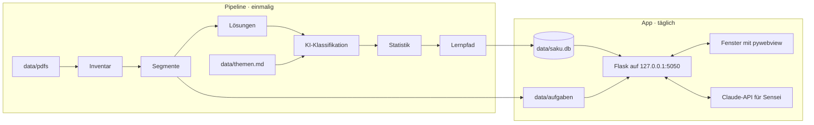
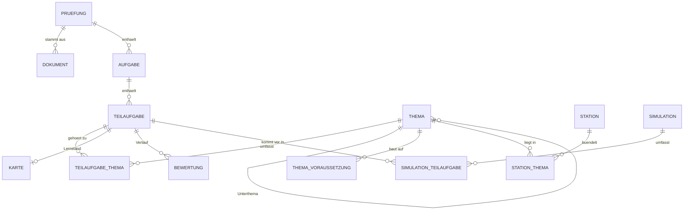

# Architektur

Saku besteht aus zwei Teilen, die sich eine SQLite-Datenbank teilen:

1. **Die Pipeline** analysiert die Prüfungs-PDFs und baut daraus den Katalog: `python -m saku analyse`
2. **Die App** ist eine lokale Flask-Web-App in einem eigenen Fenster: `python -m saku start`



## Tech-Stack

| Bereich | Technik | Warum |
|---|---|---|
| Sprache | Python 3.12+ | Kurssprache; alles Wesentliche passiert in Python |
| PDFs | PyMuPDF | Text mit Positionen, Ausschnitte als Bild, OCR-Anbindung |
| Datenbank | SQLite mit FTS5 | in Python enthalten, Volltextsuche inklusive |
| KI | Claude-API (`anthropic`) | Deckblätter, Klassifikation, Lernpfad, Tutor, Streaming |
| Web | Flask + Jinja2 | schlank, verbreitet, gut dokumentiert |
| Oberfläche | Basecoat | shadcn/ui-Look als CSS-Klassen, ohne React |
| Interaktion | htmx 2 + SSE-Erweiterung | Interaktivität per HTML-Attribut, Streaming der KI-Antworten |
| Wiederholung | `fsrs` | Wiederholungsplanung wie in Anki |
| Graph | networkx (Lernpfad), force-graph im Browser (d3-force auf Canvas) | Reihenfolge in Python, Wissensgraph wie in Obsidian |
| Ähnlichkeit | scikit-learn | TF-IDF über alle Teilaufgaben |
| Markdown | markdown-it-py | KI-Antworten als HTML, eingebettetes HTML wird entschärft |
| Terminal | rich | Fortschrittsbalken und Tabellen in der Pipeline |
| Fenster | pywebview | eigenes App-Fenster statt Browser-Tab |

Eigenes JavaScript steht in einer Datei, `static/js/saku.js`: Tastenkürzel, Rückmeldung „Gespeichert“, Farbschema, Code-Editor, ausfüllbare Tabellen und das Zeichnen des Wissensgraphen. Alles andere bringen Basecoat, htmx und force-graph mit.

## Projektstruktur

```text
saku/
├── README.md
├── requirements.txt            Laufzeit-Abhängigkeiten
├── requirements-dev.txt        Tests und Werkzeuge
├── .env.example                Vorlage für API-Schlüssel und Modelle
├── docs/                       diese Dokumentation
├── db/
│   └── schema.sql              Datenbankschema
├── data/                       PRIVAT, nicht im Git
│   ├── README.md
│   ├── themen.example.md       Format der Themenliste
│   ├── themen.md               eigene AP2-Themenliste
│   ├── pdfs/                   Prüfungen und Lösungshinweise
│   ├── aufgaben/               erzeugte Bildausschnitte
│   └── saku.db                 Katalog und Lernstand
├── saku/                       Python-Paket
│   ├── __main__.py             Befehle: init, analyse, start, assets
│   ├── config.py               liest .env
│   ├── db.py                   Verbindung, Schema, Hilfsfunktionen
│   ├── pipeline/
│   │   ├── inventar.py         Hash, Deckblatt, Text oder Scan
│   │   ├── segmente.py         Aufgaben, Teilaufgaben, Bildausschnitte
│   │   ├── loesungen.py        Lösungshinweise zuordnen
│   │   ├── themen.py           themen.md einlesen
│   │   ├── klassifikation.py   Teilaufgaben → Themen (KI)
│   │   ├── statistik.py        Ähnlichkeiten (TF-IDF), Suchindex
│   │   ├── wissen.py           Wissensseiten je Thema, Begriffs-Definitionen (KI)
│   │   ├── vektoren.py         Vektoren, „Kam so ähnlich“, Aufgabenmuster
│   │   └── lernpfad.py         Voraussetzungen, Stationen
│   ├── lernen/
│   │   ├── karten.py           Fahrschul-Regeln und FSRS
│   │   ├── tagesziel.py
│   │   └── simulation.py       Zusammenstellung, Notenschlüssel
│   ├── sensei/
│   │   ├── client.py           Claude-API, Cache, Protokoll
│   │   ├── prompts.py
│   │   ├── suche.py            Kontext für den Chat (RAG, Volltext + Vektoren)
│   │   └── vektoren.py         fastembed lokal, Kosinus, Reciprocal Rank Fusion
│   ├── niwa.py                 Wissensgraph: Knoten und Kanten für force-graph, Lehrplan
│   └── web/
│       ├── __init__.py         Flask-App-Factory
│       ├── routen/             ein Blueprint je Bereich
│       ├── templates/
│       └── static/             css/saku.css, vendor/, fonts/
└── tests/
```

## Pipeline

Die Pipeline läuft in elf Schritten. Jeder Schritt ist wiederholbar: Unveränderte Dateien (gleicher SHA-256-Hash) werden übersprungen, KI-Antworten kommen beim zweiten Lauf aus dem Cache, und Daten werden per Upsert aktualisiert, damit der Lernstand erhalten bleibt.

```bash
python -m saku analyse                  # alle Schritte
python -m saku analyse --schritt segmente
python -m saku analyse --ohne-ki        # nur lokale Schritte, kostenlos
python -m saku analyse --ki claude-code # Erstlauf: KI über das lokale Claude Code statt der API
```

| Schritt | Was passiert | Ergebnis |
|---|---|---|
| 1. Inventar | PDFs erfassen, Deckblatt lesen, Text oder Scan erkennen | `dokument`, `pruefung` |
| 2. Segmente | Aufgaben und Teilaufgaben erkennen, Ausschnitte rendern | `aufgabe`, `teilaufgabe`, PNGs |
| 3. Lösungen | Lösungshinweise segmentieren und zuordnen | `loesung_text`, `loesung_bilder` |
| 4. Aufbereiten | Claude baut jede Aufgabe aus den Ausschnitten als Markdown neu auf (KI, Bilder) | `inhalt`, `antwort`, `loesung_inhalt`, `begriff` |
| 5. Themen | `data/themen.md` und die Lernfelder einlesen | `thema`, `lernfeld` |
| 6. Klassifikation | jede Teilaufgabe Themen zuordnen (KI, nur Bereiche der Prüfung) | `teilaufgabe_thema`, `typ` |
| 7. Statistik | Ähnlichkeiten (TF-IDF, Rückfall) berechnen, Suchindex aufbauen | `aehnlichkeit`, `suche` |
| 8. Wissen | Wissensseite je Thema und Unterthema, Kurzdefinition je Fachbegriff (KI, wiederaufnehmbar) | `thema.beschreibung`, `begriff.erklaerung` |
| 9. Vektoren | lokale Vektoren (fastembed), Ähnlichkeit nach Bedeutung, Aufgabenmuster per Clustering | `vektor`, `aehnlichkeit`, `muster` |
| 10. Lernpfad | Voraussetzungen und Stationen je Pfad (AP1, AP2-1201, AP2-1202) | `thema_voraussetzung`, `station` |
| 11. Bericht | Zusammenfassung im Terminal, Details unter Analyse | rich-Tabellen |

### 1. Inventar

Für jede PDF in `data/pdfs/` (Dateinamen sind egal):

- **Hash** berechnen: erkennt Dubletten und unveränderte Dateien
- **Textebene** prüfen: Haben die meisten Seiten kaum Text, ist es ein Scan
- **Deckblatt** lesen: Termin (Sommer oder Winter, Jahr), Prüfungsbereich, Beruf, Bearbeitungszeit, Art (Aufgaben oder Lösungshinweise), Format (aktuell oder früher, etwa „Ganzheitliche Aufgabe I/II“). Zuerst per regulärem Ausdruck; klappt das nicht, liest das schnelle Modell das Deckblatt und antwortet strukturiert.

**Scans** brauchen Texterkennung. Zwei Wege, entschieden wird nach dem Inventar:

- Tesseract über PyMuPDF (`page.get_textpage_ocr(language="deu")`): kostenlos, aber Tesseract muss mit deutschem Sprachpaket installiert sein
- Claude liest das gerenderte Seitenbild: keine Installation, kostet Tokens

### 2. Segmente

PyMuPDF liefert Text mit Koordinaten (`page.get_text("dict")`). Damit ist für jede Überschrift bekannt, wo sie auf der Seite steht. Typische Muster:

```python
AUFGABE     = re.compile(r"^\s*(?:(\d+)\.\s*(?:Aufgabe|Handlungsschritt)|Aufgabe\s+(\d+))", re.M)
TEILAUFGABE = re.compile(r"^\s*([a-z]{1,2})\)\s", re.M)
PUNKTE      = re.compile(r"\((\d+(?:,\d+)?)\s*Punkte?\)")
```

Die genauen Muster werden an den echten PDFs geschärft. Für jede Teilaufgabe wird der Bereich zwischen ihrem Anfang und dem nächsten Anfang als PNG gerendert (`page.get_pixmap(clip=rechteck, dpi=200)`). Reicht eine Teilaufgabe über einen Seitenumbruch, entstehen mehrere Bilder. Die Ausgangssituation der Prüfung und die Einleitung jeder Aufgabe werden extra gespeichert, weil Teilaufgaben ohne sie oft nicht verständlich sind.

Bilder landen in `data/aufgaben/<hash>/` und werden von der App über eine eigene Route ausgeliefert, nicht über `static/`. So bleiben alle Prüfungsinhalte in `data/`.

### 3. Lösungen

Lösungshinweise werden genauso segmentiert und über Termin, Prüfungsbereich, Aufgabennummer und Kennung zugeordnet. Fehlende Lösungen tauchen im Inventar auf.

### 4. Aufbereiten

Je Aufgabe (bei WiSo mehrere zusammen) bekommt das starke Modell alle Ausschnitte als Bilder (Einleitung, Teilaufgaben, Lösungshinweise) und den erkannten Text als Hilfe. Es antwortet nach Schema: die Aufgabe als Markdown (Tabellen, Code, Listen), die Antwortart (frei, einfach, mehrfach, reihenfolge, zuordnung, zahl, code, sql, tabelle) mit Optionen und der richtigen Lösung aus dem Lösungshinweis, den Lösungshinweis als Markdown und drei bis acht Fachbegriffe. Abbildungen kommen als `` mit Box zurück; Saku schneidet sie aus dem Ausschnitt, bei Text-PDFs als SVG (Seite und Rechteck jedes Ausschnitts stehen in `ausschnitte.json`). Der Schritt ist wiederaufnehmbar: Er bearbeitet nur Aufgaben ohne Inhalt, ein fehlerhaftes Paket hält den Lauf nicht auf. Über Claude Code bekommt `claude -p` nur das Werkzeug Read und nur den Ordner der Bilder (`SAKU_KI_PARALLEL` steuert, wie viele Aufrufe gleichzeitig laufen).

### 5. Themen

`data/themen.md` wird eingelesen, das Format steht in [data/themen.example.md](../data/themen.example.md). Weicht die eigene Liste davon ab, bringt das starke Modell sie einmalig in die Struktur.

### 6. Klassifikation

Für jede Teilaufgabe bekommt das schnelle Modell die Themenliste, die Einleitung der Aufgabe, den Text der Teilaufgabe und den Lösungshinweis. Es antwortet über ein Werkzeug mit festem Schema (siehe [SENSEI.md](SENSEI.md)): passende Themen mit Gewichten (Summe 1), Aufgabentyp und Sicherheit.

Zuordnungen lassen sich in der App korrigieren. Manuelle Zuordnungen (`quelle = 'manuell'`) überschreibt die Pipeline nie.

### 7. Statistik

- **Ähnlichkeiten:** TF-IDF über Einleitung und Text jeder Teilaufgabe, Kosinus-Ähnlichkeit, gespeichert werden die drei ähnlichsten Teilaufgaben aus anderen Prüfungen ab einem Wert von 0,3
- **Suchindex:** Die FTS5-Tabelle `suche` wird neu aufgebaut
- **Häufigkeit, Punkte, Heatmap:** liegen als Sichten in der Datenbank (`v_themen_statistik`, `v_heatmap`), es muss nichts gespeichert werden

### 8. Wissen

- **Wissensseiten:** ein Aufruf je Thema (starkes Modell). Eingabe sind Thema, Unterthemen und je Unterthema die punktstärksten Teilaufgaben mit Lösungshinweis. Heraus kommt eine Übersicht zum Thema und je Unterthema „Das musst du können“, „So wird gefragt“ (mit `[T123]`-Verweisen) und „Fallen“. Die Notiz im Themengarten zeigt sie an.
- **Begriffe:** 50 Fachbegriffe je Aufruf (schnelles Modell), je zwei bis drei Sätze. Daraus werden die Begriffs-Karten im Modus Grundwissen.
- Nur leere Felder werden gefüllt; ein abgebrochener Lauf macht beim nächsten Mal weiter.

### 9. Vektoren

- **Modell:** `paraphrase-multilingual-MiniLM-L12-v2` über fastembed (ONNX, lokal, kostenlos, ca. 220 MB in `data/modelle`). Ohne Modell bleibt es bei Volltext und TF-IDF.
- **Ähnlichkeit:** die drei nächsten Teilaufgaben aus anderen Prüfungen ab Kosinus 0,62 ersetzen die TF-IDF-Werte.
- **Muster:** agglomeratives Clustering (Kosinus-Abstand ≤ 0,38); ein Muster muss in mindestens drei Prüfungen vorkommen. Der Name kommt aus den häufigsten Fachbegriffen der Gruppe.
- **Suche:** ⌘K und der Sensei-Chat verbinden Volltext- und Vektortreffer per Reciprocal Rank Fusion.

### 10. Lernpfad

1. Das starke Modell schlägt Voraussetzungen zwischen Themen vor, etwa „Routing setzt Subnetting voraus“.
2. networkx baut daraus einen gerichteten Graphen und entfernt eventuelle Zyklen (die Kante mit der geringsten Sicherheit fällt weg).
3. Die Reihenfolge ergibt sich topologisch, bei Gleichstand gewinnt das Thema mit dem höheren Punkteanteil: `nx.lexicographical_topological_sort(G, key=…)`.
4. Kleine Themen werden zu Stationen gebündelt, Ziel sind 8 bis 15 Teilaufgaben je Station.
5. Für jede Station schreibt Sensei eine kurze Einführung.

## Datenmodell

Das vollständige Schema mit Kommentaren steht in [db/schema.sql](../db/schema.sql).



Wichtige Regeln:

- **Lerneinheit** ist die Teilaufgabe. `karte` hält ihren Fahrschul-Status und den FSRS-Zustand, `bewertung` jede einzelne Bewertung.
- **Gewichte:** Die Gewichte in `teilaufgabe_thema` ergeben je Teilaufgabe zusammen 1. `pruefung.gewicht` senkt bei Bedarf den Einfluss älterer Prüfungen.
- **Sichten statt Kopien:** Statistik, Lernstand je Thema (inklusive Wachstumsstufe für Niwa), Prüfungsreife, fällige Karten und Lerntage werden live berechnet.
- **Verbindung:** `PRAGMA foreign_keys = ON` und `PRAGMA journal_mode = WAL` bei jeder Verbindung. So können Pipeline und App gleichzeitig auf die Datenbank zugreifen.
- **Migrationen:** Die Schema-Version steht in `PRAGMA user_version`.

## Die App

### Aufbau

- **App-Factory** `create_app()` in `saku/web/__init__.py`, ein Blueprint je Bereich
- **Ganze Seite oder Fragment:** Schickt htmx eine Anfrage (Header `HX-Request`), liefert die Route nur das Stück HTML, das ausgetauscht wird. Sonst die ganze Seite. So funktioniert jede URL auch direkt.
- **Start:** `python -m saku start` startet Flask in einem Thread und öffnet ein pywebview-Fenster. Mit `--browser` öffnet sich stattdessen der Standardbrowser.
- **Port 5050:** Auf macOS belegt AirPlay den Flask-Standardport 5000. Die App lauscht nur auf `127.0.0.1` und ist von außen nicht erreichbar.

### Routen

| Route | Methode | Zweck | Antwort |
|---|---|---|---|
| `/` | GET | Heute | Seite |
| `/michi` | GET | Lernpfad | Seite |
| `/michi/<station>` | GET | Station mit Einführung und Übungen | Seite |
| `/michi/<station>/test` | GET, POST | Mini-Test | Seite, Fragment |
| `/keiko` | GET | Fokusmodus; Filter `?thema=`, `?muster=`, `?modus=fehler\|markiert\|neu` | Seite |
| `/keiko/grundwissen` | GET | Begriffs-Karten (FSRS, eigener Fahrschul-Status) | Seite |
| `/keiko/grundwissen/<id>/bewerten` | POST | 1, 2 oder 3, nächste Begriffs-Karte | Fragment |
| `/keiko/<id>/loesung` | GET | Lösung aufdecken | Fragment |
| `/keiko/<id>/bewerten` | POST | 1, 2 oder 3 speichern, nächste Karte | Fragment |
| `/keiko/<id>/markieren` | POST | markieren oder entmarkieren | Fragment |
| `/shiken` | GET | Übersicht und Verlauf | Seite |
| `/shiken/neu` | POST | Simulation zusammenstellen | Weiterleitung |
| `/shiken/<id>` | GET | laufende Simulation | Seite |
| `/shiken/<id>/auswertung` | GET, POST | Punkte, Note, Stempel | Seite |
| `/niwa` | GET | Garten | Seite |
| `/niwa/thema/<id>` | GET | Seitenleiste zu einem Thema | Fragment |
| `/sensei/<modus>` | POST | Anfrage anlegen: tipp, erklaeren, pruefen, variante, thema, chat | Fragment |
| `/sensei/stream/<anfrage>` | GET | Antwort als Server-Sent Events | `text/event-stream` |
| `/bunseki` | GET | Analyse | Seite |
| `/suche` | GET | Befehlspalette und Live-Suche (Volltext + Bedeutung), `?q=` | Fragment |
| `/bild/<pfad>` | GET | Bildausschnitte aus `data/aufgaben` | Bild |
| `/einstellungen` | GET, POST | Prüfungstermin, Farbschema | Seite |

### Interaktion mit htmx

Interaktivität entsteht über HTML-Attribute, Python liefert HTML-Stücke zurück:

```html
<!-- Lösung aufdecken per Klick oder Leertaste -->
<button hx-get="/keiko/42/loesung"
        hx-target="#loesung"
        hx-trigger="click, keyup[key==' '] from:body">
  Lösung zeigen <kbd>␣</kbd>
</button>
<div id="loesung"></div>
```

Tastenkürzel werden über Trigger mit Tastenfilter umgesetzt. In Eingabefeldern sind sie abgeschaltet, damit Tippen nichts auslöst. Seitenwechsel nutzen die View-Transitions des Browsers (`hx-swap="… transition:true"`).

### Streaming von Sensei

1. Ein Klick auf „Erklären“ schickt `POST /sensei/erklaeren`. Die Route speichert den Kontext unter einer Anfrage-ID und liefert eine leere Sprechblase zurück, die sich per SSE mit `/sensei/stream/<anfrage>` verbindet.
2. Die Stream-Route ruft die Claude-API mit Streaming auf und schickt jedes Textstück als Ereignis `delta`. htmx hängt es an die Sprechblase an.
3. Am Ende folgt das Ereignis `fertig` mit der als Markdown gerenderten Antwort, die den Rohtext ersetzt.

```python
def sse(ereignis: str, daten: str) -> str:
    zeilen = "\n".join(f"data: {zeile}" for zeile in daten.split("\n"))
    return f"event: {ereignis}\n{zeilen}\n\n"

@bp.get("/sensei/stream/<anfrage_id>")
def stream(anfrage_id):
    anfrage = anfragen.hole(anfrage_id)

    def ereignisse():
        with client.messages.stream(**anfrage.parameter) as antwort:
            for stueck in antwort.text_stream:
                yield sse("delta", html.escape(stueck))
            text = antwort.get_final_text()
        yield sse("fertig", markdown_zu_html(text))

    return Response(stream_with_context(ereignisse()), mimetype="text/event-stream")
```

`markdown_zu_html` nutzt markdown-it-py mit `html: False`. HTML in KI-Antworten wird dadurch angezeigt statt ausgeführt.

### Wissensgraph (Themen)

- **Umfang:** Die Sicht `v_umfang` liest Beruf und Prüfungsteil aus den Einstellungen; `v_teilaufgabe` und alles, was darauf aufbaut, zeigt nur diesen Umfang. AP1 gilt für alle IT-Berufe, in der AP2 gelten WiSo und GA2 für alle.
- **Python bereitet die Daten vor** (`saku/niwa.py`): Bereiche, Themen und Unterthemen der Themenliste (auch nie geprüfte), Lernfelder und die häufigsten Fachbegriffe als Knoten; Gliederung, Lernfeld, Begriff ↔ Thema, gemeinsam gefragte Begriffe und Voraussetzungen als Kanten.
- **Der Browser zeichnet** mit force-graph: kleine Punkte, Beschriftung je nach Zoom, Hover hebt die Nachbarschaft hervor, ein Klick öffnet rechts die Notiz zum Knoten (`/niwa/thema|begriff|lernfeld/<id>`). Notizen verweisen über `data-knoten` zurück in den Graphen.

## Offline-Dateien

`python -m saku assets` lädt einmalig alle Fremddateien in `saku/web/static/vendor/` und `saku/web/static/fonts/`, jeweils mit Lizenzdatei. Danach läuft die App komplett offline (bis auf Sensei).

| Datei | Lizenz |
|---|---|
| Basecoat (CSS und JS) | MIT |
| htmx 2 und SSE-Erweiterung | 0BSD |
| force-graph | MIT |
| Lucide-Icons | ISC |
| Inter, Shippori Mincho, JetBrains Mono | SIL Open Font License |

Die Schrift Shippori Mincho wird auf die verwendeten Zeichen reduziert, siehe [DESIGN.md](DESIGN.md#typografie).

## Konfiguration

Alle Einstellungen außerhalb der App stehen in `.env` (Vorlage: `.env.example`):

| Variable | Bedeutung | Standard |
|---|---|---|
| `ANTHROPIC_API_KEY` | Schlüssel für die Claude-API | – |
| `SAKU_MODELL_SCHNELL` | Modell für Deckblätter, Klassifikation, Suchbegriffe | siehe `.env.example` |
| `SAKU_MODELL_STARK` | Modell für Sensei und Lernpfad | siehe `.env.example` |
| `SAKU_DATENORDNER` | Ort von PDFs, Bildern und Datenbank | `data` |
| `SAKU_PORT` | Port der App | `5050` |

Prüfungstermin und Farbschema werden in der App gesetzt und in der Tabelle `einstellung` gespeichert.

## Tests

- `pytest` mit erfundenen Textbeispielen, die das Layout der Prüfungen nachahmen. Echte Prüfungstexte kommen nie ins Repo.
- Getestet werden vor allem die Erkennungsmuster der Segmentierung, die Fahrschul-Regeln, der Notenschlüssel und das Tagesziel.

## Datenschutz und Sicherheit

- Die App lauscht nur auf `127.0.0.1`.
- `data/`, `.env` und alle PDFs sind per `.gitignore` ausgeschlossen.
- An die Claude-API gehen nur Aufgabentexte, Lösungshinweise, eigene Antworten und Fragen, keine persönlichen Daten.
- Der API-Schlüssel steht nur in `.env` und wird nie im Code oder in Logs ausgegeben.
